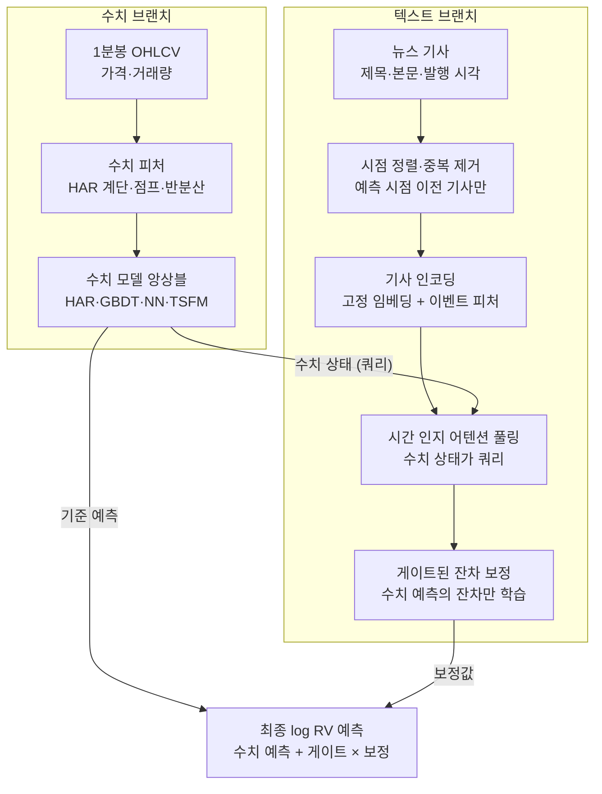

# BTC 단기 Realized Volatility 예측 모델 설계안

수치(OHLCV) + 뉴스 텍스트(CoinDesk Data API) 멀티모달 구조

| 항목 | 내용 |
|---|---|
| 작성일 | 2026-11-16 |
| 목표 | 기존 수치 데이터에 뉴스 텍스트를 더해 BTC 단기 RV 예측 성능을 SOTA급으로 끌어올린다 |
| 가정 | 1분봉 OHLCV, 매시 예측, 타깃은 향후 1h·4h·24h의 log RV |
| 표기 | `[n]`은 문서 끝 참고문헌 번호다. "판단"·"해석"이라고 적은 문장은 문헌 수치가 아닌 설계상의 의견이다 |

> 호라이즌이 5분 이하라면 뉴스 기여가 더 줄고 주문흐름 피처가 중요해져 설계가 달라진다.

## 목차

1. [핵심 방향](#1-핵심-방향)
2. [전체 구조](#2-전체-구조)
3. [타깃과 손실](#3-타깃과-손실)
4. [수치 브랜치](#4-수치-브랜치)
5. [텍스트 브랜치](#5-텍스트-브랜치)
6. [융합과 학습](#6-융합과-학습)
7. [검증](#7-검증)
8. [기대 수준](#8-기대-수준)
9. [미확정 사항과 다음 단계](#9-미확정-사항과-다음-단계)
10. [참고문헌](#참고문헌)

## 1. 핵심 방향

LLM 백본에 숫자와 텍스트를 함께 넣는 구조보다, 수치 모델을 최대한 강하게 만든 뒤 텍스트는 그 잔차만 보정하게 하는 2-브랜치 구조를 권장한다. 근거는 세 가지다.

### 1.1 텍스트 붕괴

RV 예측은 REST-TS(2026)가 text collapse라고 부른 실패가 일어나기 쉬운 조건이다. 타깃과의 자기상관이 강한 수치 입력 옆에서는 텍스트 브랜치의 출력이 기사 내용에 따라 달라지지 않게 된다. 그 논문의 해법이 잔차 전용 감독으로, 수치 예측이 남긴 오차만이 텍스트 헤드의 학습 타깃이 된다 [1].

### 1.2 LLM 백본은 불필요

- 시계열 예측에서 LLM 백본의 기여는 NeurIPS 2024의 ablation 연구에서 확인되지 않았다 [2].
- TimesX 벤치마크(ICML 2026)에서는 수치만 본 TSFM 예측과 텍스트 맥락을 받은 LLM 예측을 학습 없이 반반 섞은 조합이 MASE 0.619로 각각의 단독 성능(0.645, 0.650)을 앞질렀다. 예측을 LLM에 넘겨 다듬게 하는 복잡한 결합은 이득을 주지 못했다 [3].

### 1.3 BTC는 기준선이 높다

- 암호화폐 8종의 6시간 RV 비교 연구에서, 감성 변수 없이 QLIKE 1위를 지킨 모델은 BTC의 경우 HAR였다. 감성 변수 추가의 승률은 144개 비교 중 78개, 약 54%였다 [4].
- 주식 RV 연구에서도 뉴스의 가치는 변동성 이력 모델을 대체할 때가 아니라 그 위에 얹을 때 드러났다 [5].

## 2. 전체 구조



수치 브랜치가 기준 예측 `ŷ_num`을 내고, 텍스트 브랜치는 수치 상태를 쿼리로 뉴스 토큰을 풀링해 게이트가 걸린 보정값 `g·Δ`만 더한다. 최종 예측은 다음과 같다.

```
ŷ = ŷ_num + g·Δ
```

## 3. 타깃과 손실

- **타깃.** 1분 로그수익률 제곱합으로 RV를 만들고 log를 취한다. 1시간 호라이즌에 5분봉을 쓰면 수익률이 12개뿐이라 타깃 자체가 너무 시끄럽다.
- **계절성.** 시간대·요일 패턴은 학습 구간에서만 추정한 평균을 빼거나 주기 피처로 넣는다.
- **손실.** 학습은 log RV의 MSE가 안정적이다. 공식 비교는 QLIKE와 분산 수준 MSE로 한다. 노이즈 낀 변동성 프록시에서도 모델 순위가 보존되는 손실이 이 둘이다 [6]. 로그 예측을 수준으로 되돌릴 때는 편향 보정이 필요하다.
- **멀티 호라이즌.** 1h·4h·24h는 트렁크를 공유하는 멀티태스크 헤드로 둔다.

## 4. 수치 브랜치

성능의 대부분이 여기서 결정된다.

### 4.1 피처

피처는 전부 예측 시점까지의 1분봉으로 만든다.

| 피처 그룹 | 내용 |
|---|---|
| HAR 계단 | log RV의 1h·4h·24h·7d·30d 평균 |
| 점프 분해 | bipower variation(BV), `max(RV − BV, 0)` |
| 비대칭 | 상승·하락 realized semivariance, 직전 구간 수익률 부호 |
| 레인지 | 분봉 고가·저가 기반 Parkinson/Garman–Klass 합 |
| 거래량 | log 거래량, 같은 요일·시간대 평균 대비 초과분 |
| 달력 | FOMC·CPI 발표, 옵션 만기처럼 미리 알려진 이벤트까지 남은 시간 |
| OHLCV 밖이지만 효과가 큰 후보 | Deribit DVOL(내재변동성), 펀딩비, 미결제약정 |

### 4.2 모델

HAR → LightGBM → 소형 시퀀스 모델 → TSFM 미세조정 순으로 쌓고 평균 앙상블한다.

- 주식 RV의 대규모 비교에서 추가 예측변수는 ML 모델에 넣었을 때 큰 값어치를 했고, 기성 ML 구현들의 표본 외 정확도는 HAR 계열을 넘었다 [7].
- TimesFM을 RV에 적용한 연구에서는 계량 벤치마크와의 통계적 격차가 최신 데이터로 순차 미세조정을 한 뒤에야 생겼다 [8].
- Chronos-2처럼 공변량을 타깃과 같은 그룹에서 함께 처리하는 사전학습 모델도 후보다 [9].

## 5. 텍스트 브랜치

### 5.1 전처리

- **시점 정렬.** CoinDesk Data API의 기사 객체에는 `PUBLISHED_ON`과 `CREATED_ON`이 따로 있고, `UPVOTES`·`DOWNVOTES`·`SCORE`, 3단계 `SENTIMENT`, `KEYWORDS`, `CATEGORY_DATA`도 함께 내려온다 [10]. 기사 사용 가능 시각은 두 타임스탬프 중 늦은 쪽에 몇 분의 버퍼를 더해 잡는다.
  - 두 필드의 정확한 정의는 공식 문서 페이지가 읽히지 않아 확인하지 못했다. 보유 데이터에서 두 값의 차이 분포를 직접 확인해야 한다.
- **쓰면 안 되는 필드.** 투표·점수 필드는 성격상 발행 이후에 쌓이는 값이고, `SENTIMENT`는 산출 시점과 모델을 알 수 없다. 둘 다 빼거나 직접 재계산한다.
- **중복 제거.** 같은 사건의 재전송 기사를 임베딩 유사도로 묶어 첫 기사만 남기고, 묶음 크기는 피처로 쓴다.
- **BTC 태그만 남기지 않기.** 규제·거래소·스테이블코인·거시 기사도 변동성을 움직인다. 카테고리는 필터가 아니라 임베딩 피처로 넣는다.

### 5.2 기사 표현

- **인코더는 동결.** 제목과 리드 문단을 임베딩해 32~64차원으로 사영한다. 시간당 표본이 하나이고 자기상관이 강해 유효 표본이 적으므로, 인코더까지 미세조정하면 과적합된다.
- **인코더 선택.** 범용 임베딩 리더보드 순위는 금융 과제 성능을 잘 예측하지 못한다 [11]. 금융 적응 모델·범용 대형 모델·point-in-time 모델을 ablation으로 직접 비교한다.
- **LLM 구조화 피처.** 기사마다 다음 항목을 JSON으로 뽑는다.
  - 이벤트 유형
  - 예정/돌발 여부
  - 신규성
  - 예상 변동성 영향
  - 새 정보인가, 이미 일어난 가격 움직임의 사후 보도인가

  마지막 플래그가 특히 중요하다. 급락을 전하는 기사는 현재 RV와 상관이 높지만 lagged RV가 이미 아는 정보다.
- **뉴스 흐름 스칼라.** 15m·1h·4h·24h 창의 기사 수를 같은 요일·시간대의 과거 평균으로 정규화한다. 수집 소스 구성이 시기마다 달라질 수 있어 원시 건수는 위험하다. 최근 72시간 기사 대비 신규성도 넣는다.

### 5.3 풀링 입력

최근 24시간의 기사 최대 K개를 토큰으로 삼는다. 각 토큰은 다음의 합이다.

- 사영 임베딩
- 경과 시간 임베딩
- 소스·카테고리 임베딩

기사가 없으면 학습 가능한 null 토큰을 쓴다.

## 6. 융합과 학습

### 6.1 헤드 구조

최종 예측은 `ŷ = ŷ_num + g·Δ`다.

- `Δ`: 수치 상태 벡터를 쿼리로 뉴스 토큰에 cross-attention한 뒤 MLP로 낸 스칼라
- `g`: 시그모이드 게이트
- 마지막 층을 0으로 초기화하면 수치 기준선에서 출발하므로 텍스트가 성능을 깎기 어렵다.

### 6.2 수치 상태를 쿼리로 쓰는 이유

- 뉴스 피드로 가격 점프를 설명하려던 고빈도 주식 연구에서는 대부분의 점프에서 짝이 되는 기사를 찾지 못했다 [12].
- CFM 연구진은 점프 주변과 뉴스 주변의 변동성 추이를 따로 측정해 둘을 별개 메커니즘으로 구분했다 [13][14].
- 해석: 텍스트의 역할은 "충격이 온다"를 알리는 것보다 "지금 충격이 어떤 종류인가"를 가려 주는 쪽이다. 그러려면 텍스트와 변동성 상태의 상호작용이 필요하다.

### 6.3 학습 순서

1. 수치 모델을 walk-forward로 학습한다.
2. 수치 모델을 동결하고, 그 out-of-fold 예측의 잔차로 텍스트 헤드를 학습한다. in-sample 잔차는 실제보다 작아서 헤드가 엉뚱한 타깃을 배운다.
3. 선택적으로 낮은 학습률의 공동 미세조정과 modality dropout을 더한다.

### 6.4 대조군과 진단

- **반드시 같이 돌릴 대조군.** 수치 피처 + 텍스트 스칼라 + 풀링 임베딩의 주성분 몇 개를 넣은 LightGBM이다. 텍스트를 추가 시간 채널로 바꿔 수치와 같은 백본에 태우는 TAC-Time식 구성 [15]도 TSFM 공변량으로 쉽게 재현된다. cross-attention 헤드가 이 둘을 못 이기면 구조가 과한 것이다.
- **텍스트 사용 여부 진단.** 텍스트 입력을 제거한 채 예측을 다시 내고 원래 예측과의 차이를 모델 오차 대비 비율로 잰다. 이 비율이 0에 붙어 있으면 텍스트 헤드는 죽어 있는 것이다 [1].

### 6.5 추가 개선안

- **기사 단위 보조 감독.** 각 기사 직후의 (실현 log RV − 수치 예측)을 기사 임베딩으로 맞히는 작은 헤드를 사전학습한다. 감독 표본이 시점 수가 아니라 기사 수만큼 늘어난다.
- **패널 학습.** ETH·SOL 등을 묶어 학습한다. 같은 이유로 도움이 된다.

## 7. 검증

SOTA 주장은 여기서 갈린다.

### 7.1 현황

BTC RV + 뉴스에는 합의된 벤치마크가 없다. 2026년에 나온 암호화폐 시간 단위 변동성 + 뉴스 모델(MODEL)을 보면 비교 상대가 FEDformer·PatchTST·TimeMixer 같은 범용 장기예측 모델이고, 평가는 7:2:1 단일 분할, BTC에서 TimeCMA 대비 MSE 차이는 약 0.7%다 [16]. HAR 계열을 walk-forward에서 통계적으로 이기는 것 자체가 기여가 된다.

### 7.2 프로토콜

| 항목 | 내용 |
|---|---|
| 분할 | 주기적으로 재학습하는 walk-forward. 학습 끝과 검증 시작 사이를 최대 호라이즌만큼 purge |
| 적합 범위 | 스케일러·계절성·PCA는 학습 구간에서만 적합 |
| 기준선 | HAR 계열(로그 HAR, 점프·반분산 확장), LightGBM, 수치 전용 딥러닝, TSFM(zero-shot·미세조정), 본 모델의 수치 전용 버전 |
| 지표 | QLIKE, 분산 수준 MSE, HAR 대비 표본 외 R² |
| 검정 | Diebold–Mariano(HAC 표준오차), Model Confidence Set |
| 구간별 성능 | RV 상위 10%, 뉴스 밀집 구간, 예정 이벤트 창 |
| Placebo | 뉴스 타임스탬프를 +1일·+7일 밀면 이득이 사라져야 한다. 기사 수만 쓴 모델 대비 내용 임베딩의 추가 이득도 따로 보인다 |

### 7.3 LLM look-ahead 편향

- 시점 일관 모델인 ChronoBERT의 임베딩으로 만든 뉴스 기반 익일 수익률 전략은 훨씬 큰 Llama 기반 전략과 샤프 비율에서 갈리지 않았다 [17]. 임베딩을 피처로만 쓰는 구성은 비교적 안전해 보인다.
- 다만 TimesX의 컷오프 전후 비교에서 LLM 예측기는 컷오프 이전 구간에서 12~15%만큼의 누수 덕을 보고 있었다 [3].
- LLM 구조화 피처까지 쓴다면 최종 테스트 구간을 해당 LLM의 학습 컷오프 이후로 잡는다.
- 각 날짜보다 1년 앞선 지식 컷오프의 TiMaGPT로 뉴스를 임베딩한 M2VN [18]처럼 point-in-time 인코더를 대조군으로 둔다.

## 8. 기대 수준

- 일간 미국 주식을 다룬 M2VN에서 뉴스 입력의 몫은 QLIKE 기준으로 종목에 따라 0에 가까운 값부터 약 11%까지 흩어져 있었다 [18].
- 판단: BTC 시간 단위에서는 평균 QLIKE 한 자릿수 % 개선이면 좋은 결과이고, 이득은 이벤트 구간에 몰릴 가능성이 높다.
- 따라서 구간별 평가와 placebo가 결과의 핵심 표가 된다.

## 9. 미확정 사항과 다음 단계

- 실제 예측 호라이즌, 봉 주기, 뉴스 데이터 기간을 확정한다. 이 문서의 가정(1분봉, 매시 예측, 1h·4h·24h)과 다르면 설계를 조정한다.
- `PUBLISHED_ON`과 `CREATED_ON`의 정의를 공식 문서나 보유 데이터의 차이 분포로 확인한다.
- 위 항목이 정해지면 피처 파이프라인과 융합 헤드의 PyTorch 골격을 작성한다.

## 참고문헌

1. *Does Text Actually Help? Uncovering and Resolving Text Collapse in Multimodal Time Series Forecasting* (REST-TS). arXiv:2606.19413, 2026. <https://arxiv.org/abs/2606.19413>
2. Tan, Merrill, Gupta, Althoff, Hartvigsen. *Are Language Models Actually Useful for Time Series Forecasting?* NeurIPS 2024. <https://arxiv.org/abs/2406.16964>
3. *Rethinking Multimodal Time-Series Forecasting Evaluation* (TimesX). ICML 2026, arXiv:2607.06973. <https://arxiv.org/abs/2607.06973>
4. Brauneis 외. *Crypto Volatility Forecasting: Mounting a HAR, Sentiment, and Machine Learning Horserace*. Springer, 2024. <https://link.springer.com/article/10.1007/s10690-024-09510-6>
5. *Realised Volatility Forecasting: Machine Learning via Financial Word Embedding*. arXiv:2108.00480. <https://arxiv.org/abs/2108.00480>
6. Patton (2011). *Volatility forecast comparison using imperfect volatility proxies*. Journal of Econometrics. (링크 미첨부)
7. *A machine learning approach to volatility forecasting*. arXiv:2601.13014. <https://arxiv.org/html/2601.13014v1>
8. Goel, Pasricha, Magris, Kanniainen. *Foundation Time-Series AI Model for Realized Volatility Forecasting*. arXiv:2505.11163, 2025. <https://arxiv.org/abs/2505.11163v1>
9. *Chronos-2: From Univariate to Universal Forecasting*. arXiv:2510.15821. <https://arxiv.org/html/2510.15821v1>
10. CoinDesk Data API(구 CCData/CryptoCompare) News API OpenAPI 스펙. <https://apis.io/apis/cryptocompare/cryptocompare-news-api/>
11. Tang, Yang. *FinMTEB: Finance Massive Text Embedding Benchmark*. EMNLP 2025. <https://arxiv.org/abs/2502.10990v2>
12. *So Many Jumps, So Few News*. NBER Working Paper 32746. <https://nber.org/papers/w32746>
13. *Stock price jumps: news and volume play a minor role* (CFM). arXiv:0803.1769. <https://www.cfm.com/stock-price-jumps-news-and-volume-play-a-minor-role/>
14. *The endogenous dynamics of markets: price impact and feedback loops*. arXiv:1009.2928. <https://arxiv.org/pdf/1009.2928>
15. *TAC-Time: Texts as Channels For Multimodal Time Series Forecasting*. arXiv:2609.24156. <https://arxiv.org/abs/2609.24156>
16. *Multimodal Cryptocurrency Volatility Prediction Analysis Based on LLM* (MODEL). ScienceDirect, 2026. <https://www.sciencedirect.com/science/article/pii/S2096720926000412>
17. He, Lv, Manela, Wu. *Chronologically Consistent Large Language Models*. arXiv:2502.21206. <https://arxiv.org/html/2502.21206v3>
18. *Fusing Narrative Semantics for Financial Volatility Forecasting* (M2VN). arXiv:2510.20699. <https://arxiv.org/html/2510.20699v1>
